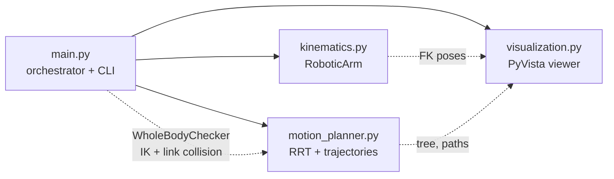

# 6-DOF Robotic Arm Kinematics Simulator & Trajectory Planner


A from-scratch robotics software stack for a 6-axis industrial arm (UR5 geometry). It
covers Denavit-Hartenberg forward kinematics, an analytic Jacobian, singularity-robust
inverse kinematics with null-space posture control, a **configuration-aware RRT** path
planner, spline smoothing, minimum-jerk timing and real-time 3D playback. All of it is
written by hand on NumPy and SciPy, with no ROS and no robotics libraries.


---

## Highlights

| What | Result (measured) |
|---|---|
| Forward kinematics | Matches the published UR5 home pose `(-0.81725, -0.19145, -0.00549) m` to machine precision |
| Analytic Jacobian | Agrees with a finite-difference Jacobian to **2.5 × 10⁻¹⁰** over 200 random configurations |
| Position IK | **300 / 300** random reachable targets solved, **< 1 ms** per solve on average |
| Singularity robustness | Converges even when started *exactly* at a singular pose (σ_min = 0); unreachable targets return a finite best-effort answer instead of blowing up |
| Whole-arm collision avoidance | Gripper-only planning let the forearm hit the pillar in **5 / 5** seeds; the configuration-aware planner kept the **entire arm** clear in **8 / 8** seeds (≥ 1 cm gap) |
| Trajectory tracking | 0.01 mm max TCP error, ~1.7 IK iterations per frame (warm-started) |
| Full pipeline | Plan, smooth, time and solve 240 frames in about **0.2 to 0.4 s** |
| Rendering | ~30 fps interactive playback; 1.2 MB demo GIF (down from 17 MB using delta-frame encoding) |

---

## Architecture



| Module | Responsibility | Key ideas |
|---|---|---|
| [`kinematics.py`](kinematics.py) | `RoboticArm`: DH model, FK, Jacobian, IK | Vectorised DH transforms; analytic geometric Jacobian; SVD-based damped least squares with adaptive damping, trust region, line search, null-space posture task and random restarts |
| [`motion_planner.py`](motion_planner.py) | Obstacles, `Environment`, `RRTPlanner`, smoothing, timing | Signed-distance-field collision checks with a no-tunnelling guarantee; pre-allocated tree with vectorised nearest-neighbour; greedy shortcutting; collision-validated cubic spline; minimum-jerk profile |
| [`visualization.py`](visualization.py) | `ArmRenderer`, `SimulationViewer` | Each rigid link is meshed once in its local DH frame, and animating only updates 4×4 actor matrices. Live HUD, embedded joint-angle chart, GIF/MP4 export |
| [`main.py`](main.py) | End-to-end pipeline + CLI | `WholeBodyChecker` connects robot and planner; plan, verify and re-plan loop |
| [`tests/`](tests) | 28 unit + integration tests | FK/Jacobian/IK correctness, planner guarantees, end-to-end safety |

**Design decisions worth noting**

1. **The planner knows nothing about robots.** `RRTPlanner` accepts any `state_validator(point) -> bool`.
   `main.py` plugs in a `WholeBodyChecker` that solves IK for each candidate waypoint and checks every
   link of the arm against the obstacles. You could reuse the same planner for a drone or a gantry.
2. **Drawn geometry never exceeds the collision model.** Links fit inside 4.5 cm capsules, and every
   joint housing is inscribed in a 7 cm sphere. "No collision" in the report therefore means nothing
   overlaps on screen either.
3. **Verify, then trust.** After IK tracking, every frame is collision-checked again. If anything fails,
   the pipeline re-plans with a new random seed.

---

## The Mathematics

### 1. Denavit-Hartenberg forward kinematics

Each joint $i$ is described by four parameters $(a_i, \alpha_i, d_i, \theta_i)$. The homogeneous
transform from frame $i-1$ to frame $i$ is

$$
{}^{i-1}T_i = \mathrm{Rot}_z(\theta_i)\,\mathrm{Trans}_z(d_i)\,\mathrm{Trans}_x(a_i)\,\mathrm{Rot}_x(\alpha_i) =
\begin{bmatrix}
\cos\theta_i & -\sin\theta_i\cos\alpha_i & \sin\theta_i\sin\alpha_i & a_i\cos\theta_i \\
\sin\theta_i & \cos\theta_i\cos\alpha_i & -\cos\theta_i\sin\alpha_i & a_i\sin\theta_i \\
0 & \sin\alpha_i & \cos\alpha_i & d_i \\
0 & 0 & 0 & 1
\end{bmatrix}
$$

and the tool pose is the product of the chain:

$$
{}^{W}T_{\text{TCP}}(\mathbf{q}) = T_{\text{base}} \left( \prod_{i=1}^{6} {}^{i-1}T_i(q_i) \right) T_{\text{tool}}
$$

UR5 parameters used (standard DH, from Universal Robots):

| Joint | $a_i$ [m] | $\alpha_i$ | $d_i$ [m] |
|:-:|--:|:-:|--:|
| 1 | 0 | $\pi/2$ | 0.089159 |
| 2 | -0.425 | 0 | 0 |
| 3 | -0.39225 | 0 | 0 |
| 4 | 0 | $\pi/2$ | 0.10915 |
| 5 | 0 | $-\pi/2$ | 0.09465 |
| 6 | 0 | 0 | 0.0823 |

### 2. Geometric Jacobian

For a revolute joint with axis $\mathbf{z}_{i-1}$ through origin $\mathbf{o}_{i-1}$, column $i$ of the Jacobian is

$$
J_i(\mathbf{q}) =
\begin{bmatrix} \mathbf{z}_{i-1} \times (\mathbf{p}_{\text{TCP}} - \mathbf{o}_{i-1}) \\ \mathbf{z}_{i-1} \end{bmatrix},
\qquad
\begin{bmatrix} \mathbf{v} \\ \boldsymbol{\omega} \end{bmatrix} = J(\mathbf{q})\,\dot{\mathbf{q}}
$$

Distance to a singularity is measured by the smallest singular value $\sigma_{\min}(J)$ and by the
Yoshikawa manipulability $w = \sqrt{\det(JJ^\top)} = \prod_i \sigma_i$.

### 3. Inverse kinematics: damped least squares with null-space control

The task error is $\mathbf{e} = \mathbf{p}_d - \mathbf{p}(\mathbf{q})$ (plus the rotation vector
$\log(R_d R^\top)^\vee$ when orientation is constrained). Each iteration takes the step

$$
\Delta\mathbf{q} = \underbrace{J^\top \left(JJ^\top + \lambda^2 I\right)^{-1}\mathbf{e}}_{\text{primary task}}
\;+\; \underbrace{\left(I - J^{+}J\right) k\,(\mathbf{q}_{\text{rest}} - \mathbf{q})}_{\text{posture task in } \mathrm{null}(J)}
$$

computed from a single SVD $J = U\Sigma V^\top$:

$$
J^{+}_{\lambda} = \sum_i \frac{\sigma_i}{\sigma_i^2 + \lambda^2}\,\mathbf{v}_i\mathbf{u}_i^\top,
\qquad
I - J^{+}J = I - V_r V_r^\top
$$

**Singularity handling.** The damping only switches on near a singularity and ramps up smoothly:

$$
\lambda^2 =
\begin{cases}
0, & \sigma_{\min} \ge \varepsilon \\
\left(1 - \left(\sigma_{\min}/\varepsilon\right)^2\right)\lambda_{\max}^2, & \sigma_{\min} < \varepsilon
\end{cases}
$$

Far from singularities this is the exact pseudo-inverse, which converges fast. Near them, joint
velocities stay bounded instead of shooting to infinity. A trust region caps
$\|\Delta\mathbf{q}\|_\infty$, a backtracking line search only accepts steps that reduce
$\|\mathbf{e}\|$, and random restarts escape local minima.

Position-only IK uses 6 joints for 3 constraints, which leaves 3 redundant degrees of freedom.
The null-space term spends them on keeping the arm near a comfortable elbow-up, tool-down posture
without moving the gripper at all.

### 4. Collision checking with signed distance fields

$$
\phi_{\text{sphere}}(\mathbf{p}) = \|\mathbf{p} - \mathbf{c}\| - r,
\qquad
\phi_{\text{box}}(\mathbf{p}) = \big\|\max(\mathbf{u}, 0)\big\| + \min\!\big(\max_k u_k,\, 0\big),
\quad \mathbf{u} = |\mathbf{p} - \mathbf{c}| - \mathbf{h}
$$

Every SDF is 1-Lipschitz ($|\phi(\mathbf{x}) - \phi(\mathbf{y})| \le \|\mathbf{x} - \mathbf{y}\|$).
Sampling a segment every $h$ metres and requiring $\phi \ge c$ at each sample therefore guarantees
$\phi \ge c - h/2$ along the **entire continuous segment**. With $h = c/2$ the planner cannot
tunnel through thin obstacles. A unit test checks this against a 2 mm wall.

### 5. Rapidly-exploring Random Tree (RRT)

```
tree <- {x_start}
repeat:
    x_rand    <- goal with probability p_goal, else uniform sample in workspace
    x_near    <- argmin over tree of ||x - x_rand||             (one vectorised pass)
    x_new     <- x_near + min(1, eta / ||x_rand - x_near||) * (x_rand - x_near)
    if edge(x_near, x_new) is collision-free AND whole arm is feasible at x_new:
        add x_new with parent x_near
        if ||x_new - x_goal|| <= eta and edge(x_new, x_goal) is free: done
```

The raw tree path is then **shortcut** greedily: from each waypoint, jump to the furthest visible
waypoint. By the triangle inequality this can never make the path longer.

### 6. Smoothing and minimum-jerk timing

A natural cubic spline (C² continuous) is fitted through the waypoints using chord-length
parameterisation. If it clips an obstacle, the control polygon is subdivided and the spline refitted.
That pulls the curve towards the known-safe polyline, so the result is always collision-free.

Arc length is then timed with the quintic minimum-jerk profile:

$$
s(\tau) = L\left(10\tau^3 - 15\tau^4 + 6\tau^5\right), \qquad \tau = t/T
$$

It has zero velocity *and* zero acceleration at both ends, and peaks at $\dot{s}_{\max} = \tfrac{15}{8}\,L/T$.
That is how `--speed` is turned into a motion duration.

---

## Setup

Requires macOS or Linux, Python **3.11 to 3.14** (VTK, the 3D engine behind PyVista, does not
publish Python 3.15 wheels yet), and an internet connection for the first install.

```bash
cd 6dof-robotics-simulator
./setup.sh
```

`setup.sh` creates an isolated `.venv` and installs `numpy`, `scipy` and `pyvista` from
[`requirements.txt`](requirements.txt). If no compatible Python is installed, it uses
[`uv`](https://docs.astral.sh/uv/) to fetch a standalone CPython 3.13 just for this project.

Manual alternative, if you already have Python 3.11 to 3.14:

```bash
python3.13 -m venv .venv
source .venv/bin/activate
pip install -r requirements.txt
```

**VS Code:** open the folder, press `Cmd/Ctrl+Shift+P`, choose **Python: Select Interpreter**, and pick `.venv/bin/python`.

---

## Running

```bash
source .venv/bin/activate

python main.py                              # interactive, animated 3D window
python main.py --seed 3 --speed 0.25        # different RRT seed, slower motion
python main.py --export docs/demo.gif       # render the animation off-screen
python main.py --screenshot docs/hero.png   # mid-motion still image
python main.py --headless                   # pipeline + report only, no graphics
python -m unittest -v                       # run all 28 tests
```

**Viewer controls:** `space` pause/resume · `n` restart · `g` toggle RRT tree · `v` isometric view ·
mouse to rotate/zoom/pan · `q` quit.

| Flag | Default | Meaning |
|---|---|---|
| `--seed` | 7 | RRT random seed |
| `--frames` | 240 | Trajectory samples |
| `--speed` | 0.35 | Peak TCP speed [m/s] |
| `--fps` | 30 | Playback frame rate |
| `--export PATH` | – | Write `.gif` (built in) or `.mp4` (needs `pip install "imageio[ffmpeg]"`) |
| `--gif-width` | 960 | GIF width in pixels |
| `--screenshot PATH` | – | Save a `.png` |
| `--headless` | off | Skip rendering |
| `--hide-tree` | off | Start with the RRT tree hidden |
| `--no-loop` | off | Play the motion once |

**Sample console report**

```
==========================================================================
 6-DOF Robotic Arm Kinematics Simulator & Trajectory Planner
==========================================================================
 Robot         UR5 (DH model), 6 revolute joints, 10 cm gripper
 Workcell      2 obstacles, TCP clearance 6 cm
 Body model    link capsules r=4.5 cm, joint spheres r=7.0 cm
 RRT search    499 iterations, 235 nodes, 842 ms, 658 whole-body IK checks
 Path          raw 42 wp / 2.00 m  ->  shortcut 6 wp / 1.51 m  ->  spline 1.55 m
 Trajectory    minimum-jerk, 8.31 s, 240 frames
 IK tracking   max error 0.010 mm, 1.7 iterations/frame
 Joint motion  peak joint speed 61.2 deg/s
 Singularity   min sigma(Jv) = 0.273  (damping below 0.050)
 Safety        min arm-to-obstacle gap 1.2 cm
 Total         0.93 s on 1 planning attempt(s)
==========================================================================
```


---

## Project structure

```
6dof-robotics-simulator/
├── kinematics.py          # RoboticArm: DH FK, Jacobian, DLS IK
├── motion_planner.py      # SDF obstacles, RRT, shortcutting, spline, minimum-jerk
├── visualization.py       # PyVista renderer, HUD, joint chart, GIF/MP4 export
├── main.py                # pipeline orchestrator + CLI
├── tests/
│   ├── test_kinematics.py
│   ├── test_motion_planner.py
│   └── test_pipeline.py
├── docs/
│   ├── demo.gif
│   └── hero.png
├── requirements.txt
├── setup.sh
└── README.md
```

---

## Roadmap / ideas to extend

- **RRT\*** or **RRT-Connect**: asymptotically optimal or bidirectional search
- **Joint-space planning**: plan directly in $\mathbb{R}^6$ so self-collisions are handled too
- **Orientation-constrained paths**: keep a cup level while it moves (full 6-D IK is already implemented)
- **Time-optimal parameterisation** under joint velocity and acceleration limits (TOPP)
- **Dynamics**: Recursive Newton-Euler inverse dynamics to compute motor torques
- **Analytic IK** for the UR5's closed-form solution, benchmarked against the numerical solver

---

## LinkedIn Showcase Strategy

*Written for a 16-year-old student who wants this project to open doors: internships, research
programmes, university applications and mentors.*

### 1. Own it before you post it

Recruiters and engineers who reply will ask follow-up questions. The post turns into opportunities
only if you can answer them, so before posting:

- **Be able to whiteboard three things:** the DH transform, why $J_v$ uses a cross product, and why
  plain pseudo-inverse IK explodes at singularities (and how damping fixes it).
- **Make one change that is truly yours**, for example a new obstacle course, RRT-Connect, or keeping
  the gripper level. Your change becomes the most authentic part of the story.
- **Be transparent about your tools.** If AI helped you write code, say so plainly and say what *you*
  did: verified the math, debugged, designed the scenario, extended it. Using AI well is a real
  engineering skill, and being caught overclaiming costs far more than honesty does.

### 2. Lead with the story, not the stack

The most compelling part of this project is a failure mode it had to solve. Planning only for the
**gripper** produces paths that look perfect, yet the forearm smashes through the pillar. The fix
is to check the **whole arm** at every waypoint by solving inverse kinematics on the fly. That took
collisions from 5/5 runs to 0/8.

**Reproduce it yourself before you tell the story.** In `run_pipeline` in `main.py`, temporarily
pass `state_validator=None` to `RRTPlanner`. Every plan will then be rejected with a negative
"arm clearance". Work out *why* the gripper-only path fails, then restore the validator. Once
you've seen it and can explain it, it is your story to tell:

> *"A gripper-only planner looked perfect, but the forearm went straight through the pillar.
> Checking the whole arm at every waypoint fixed it: collisions went from 5/5 runs to 0/8."*

A problem, a diagnosed cause and a measured fix are exactly what engineering interviewers look for.

### 3. Post template (aim for roughly 1,200 characters)

```
I built a simulator where a 6-axis robot arm plans its own path around obstacles. 🤖

No ROS, no robotics libraries: every equation is implemented from scratch in Python + NumPy.
[How you built it, e.g. "with an AI pair-programmer, then verified and extended the math myself"]

What's under the hood:
• Forward kinematics from Denavit-Hartenberg parameters (matches the real UR5's geometry)
• Inverse kinematics with a damped Jacobian pseudo-inverse that survives singularities
• An RRT path planner + spline smoothing + minimum-jerk timing for smooth motion
• Real-time 3D simulation in PyVista

The most interesting lesson: checking only whether the *gripper* avoids obstacles isn't
enough. The forearm went straight through the pillar in every run. 😅 The fix was to check
the WHOLE arm at every waypoint. Collisions: 5/5 runs → 0/8.

[One sentence about the part YOU added or changed]

I'm 16 and want to work in robotics. Next up: [your next feature].
If you work in motion planning, I'd love feedback on my approach.

Code + math write-up: link in the first comment 👇

#Robotics #Python #MotionPlanning #STEM #LinearAlgebra
```

### 4. Assets that get attention

| Asset | Where | Why |
|---|---|---|
| Native video (`pip install "imageio[ffmpeg]"`, then `python main.py --export demo.mp4`) | Upload directly to the post | Motion stops the scroll; a native upload plays in the feed |
| `docs/demo.gif` | Top of the GitHub README | The first thing a recruiter sees when they click through |
| `docs/hero.png` | LinkedIn **Featured** section and **Projects** entry | Shows the HUD, joint chart and planner tree in one frame |
| PDF carousel (5 to 7 slides) | A follow-up post a week later | Problem → math → the forearm bug → result → what's next |

### 5. Profile polish

- **Headline:** `High School Student | Robotics & Motion Planning | Python · Linear Algebra`
- **Projects section:** add this project and link the GitHub repo. Skills: *Python, NumPy, SciPy,
  Linear Algebra, Kinematics, Motion Planning, 3D Visualization, Unit Testing*.
- **Featured:** pin the post and the repo.
- **GitHub:** add a licence (MIT is common), a description and topics (`robotics`, `inverse-kinematics`, `rrt`).

### 6. After posting

- Reply to every comment within the first few hours. Thoughtful replies are where the conversations
  and connections come from.
- Send personalised connection requests to a few robotics engineers, university lab members or
  competition mentors, mentioning one specific thing in their work.
- Turn it into a series: *Part 2: making it optimal with RRT\**. Consistency beats one viral post.

### 7. Avoid

- Calling it "AI" or "production-ready". It is a **simulator and planning stack**, and that is impressive enough.
- Hashtag spam (3 to 5 relevant tags is plenty) and tagging big companies who weren't involved.
- Leading with your age as the hook. Lead with the work; your age makes it *more* impressive once
  people are already interested.

---

## License


